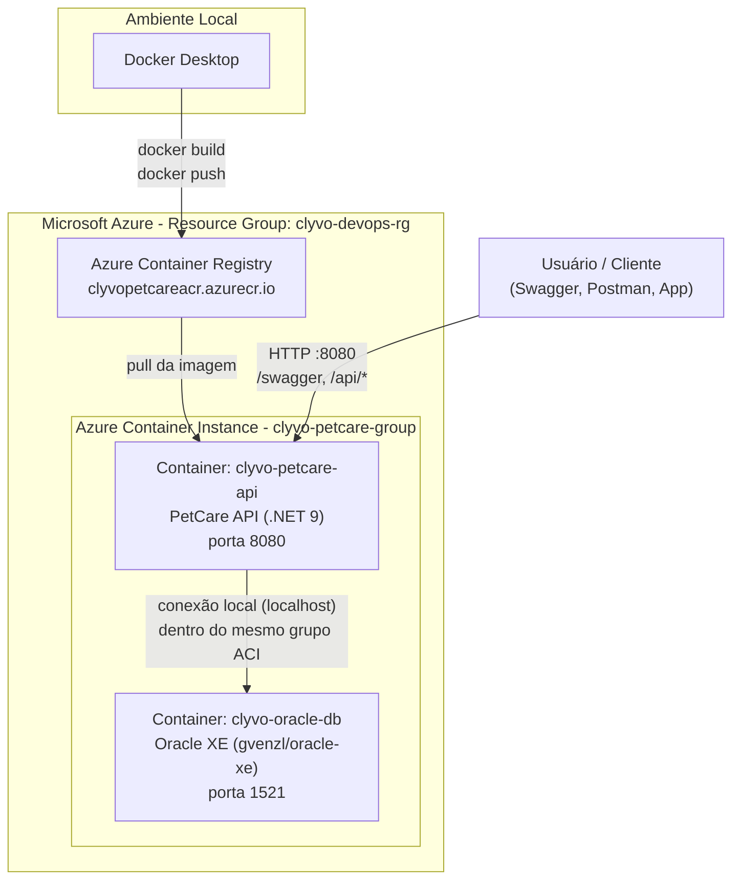

# PetCare API — Challenge FIAP 2026 | DevOps Tools & Cloud Computing

**Aluno:** Henrique Teixeira Cesar | **RM:** 563088

**Aluno:** Lucas Rafael Solimene | **RM:** 565194

**Aluno:** Samyr Couto Oliveira | **RM:** 565562

**Turma:** 2TDSPF | 
**Empresa:** Clyvo Vet | 
**Disciplina:** DevOps Tools & Cloud Computing — Sprint 3 | 


---

## Descrição da Solução

O **PetCare** é uma API REST desenvolvida em **.NET 9**, seguindo os princípios de **Clean Architecture**, criada como solução para a **Clyvo Vet**, uma clínica veterinária que precisava digitalizar o controle de tutores, pets, consultas, vacinas e histórico de saúde dos animais atendidos.

A API permite o cadastro e gerenciamento completo de:

- **Tutores** — donos dos pets
- **Pets** — animais vinculados a um tutor
- **Clínicas** — unidades de atendimento
- **Vacinas** — catálogo de vacinas disponíveis
- **Aplicações de Vacina** — histórico de vacinação de cada pet
- **Consultas** — atendimentos realizados em uma clínica
- **Histórico de Saúde** — registros gerais de saúde do pet

A autenticação é feita via **JWT (JSON Web Token)**, protegendo os endpoints sensíveis (como os de `Pet`) contra acesso não autorizado.

Nesta Sprint, o foco foi levar essa aplicação para a nuvem, containerizando tanto a API quanto o banco de dados, e automatizando o processo de deploy na **Microsoft Azure**.

## Benefício de Negócio

Para a Clyvo Vet, essa solução representa:

- **Centralização de dados**: histórico completo de cada pet acessível em um único sistema, eliminando fichas em papel ou planilhas soltas.
- **Escalabilidade**: por rodar em containers na nuvem, a infraestrutura pode crescer conforme a clínica expande (novas unidades, mais pets cadastrados) sem necessidade de reestruturação.
- **Disponibilidade**: a aplicação fica acessível via internet, permitindo que veterinários consultem o histórico de um pet em qualquer unidade da rede.
- **Segurança**: autenticação via JWT garante que apenas usuários autorizados alterem dados sensíveis (cadastro de pets).
- **Redução de custo operacional**: a arquitetura containerizada com Azure Container Instances (ACI) permite pagar apenas pelos recursos efetivamente utilizados, sem manter servidores dedicados ociosos.

## Arquitetura da Solução

A solução foi entregue na modalidade **ACR + ACI** (Azure Container Registry + Azure Container Instances), com **aplicação e banco de dados totalmente containerizados**.



### Componentes

| Componente | Descrição |
|---|---|
| **Resource Group** | `clyvo-devops-rg`, região `brazilsouth` |
| **Azure Container Registry (ACR)** | `clyvopetcareacr`, SKU Basic, armazena a imagem da API |
| **Azure Container Instance (ACI)** | Grupo de containers `clyvo-petcare-group`, com 2 containers no mesmo grupo (comunicação via `localhost`) |
| **Container da API** | `clyvo-petcare-api`, imagem `clyvopetcareacr.azurecr.io/petcare-api:v1`, porta 8080 |
| **Container do Banco** | `clyvo-oracle-db`, imagem `gvenzl/oracle-xe:latest`, porta 1521 |
| **DNS público** | `petcarerm563088.brazilsouth.azurecontainer.io` |

### Por que ACR + ACI?

Essa opção foi escolhida por atender ao requisito de a solução ficar totalmente containerizada, sem depender de serviços gerenciados de banco de dados da Azure o Oracle roda como um container próprio, dentro do mesmo grupo de containers da API, permitindo comunicação direta via `localhost`.

## Containerização

O `Dockerfile` da API utiliza **multi-stage build**, reduzindo o tamanho final da imagem, e executa a aplicação com um usuário não-root (`USER app`), seguindo boas práticas de segurança em containers.

```dockerfile
# Build multi-stage
# Estágio 1: build da aplicação .NET
# Estágio 2: imagem final, enxuta, rodando como usuário não-root "app"
# Porta exposta: 8080
# ENV ASPNETCORE_URLS=http://+:8080
```

## Passo a Passo do Deploy no Azure

### 1. Criar o Resource Group

```bash
az group create --name clyvo-devops-rg --location brazilsouth
```

### 2. Criar o Azure Container Registry (ACR)

```bash
az acr create --resource-group clyvo-devops-rg --name clyvopetcareacr --sku Basic --admin-enabled true
```

### 3. Build e push da imagem (build local, via Docker Desktop)

> **Observação importante:** a assinatura de estudante da FIAP bloqueia o uso de `az acr build` (erro `TasksOperationsNotAllowed`). Por isso, o build foi feito **localmente**, no Docker Desktop, com push manual para o ACR.

```bash
# Login no ACR
docker login clyvopetcareacr.azurecr.io -u <usuario> -p <senha>

# Build da imagem
docker build -t clyvopetcareacr.azurecr.io/petcare-api:v1 .

# Push para o ACR
docker push clyvopetcareacr.azurecr.io/petcare-api:v1
```

### 4. Criar o grupo de containers (ACI) com API + banco

Foi criado um arquivo `aci-container-group.yaml` definindo os dois containers (API e Oracle) no mesmo grupo, permitindo comunicação via `localhost`:

```bash
az container create --resource-group clyvo-devops-rg --file aci-container-group.yaml
```

O YAML define:
- Container `clyvo-oracle-db`, imagem `gvenzl/oracle-xe:latest`, porta `1521`, variável `ORACLE_PASSWORD`
- Container `clyvo-petcare-api`, imagem do ACR, porta `8080`, variáveis de conexão (`ConnectionStrings__...`) e JWT (`Jwt__Key`, `Jwt__Issuer`, `Jwt__Audience`)
- DNS label público: `petcarerm563088`

### 5. Obter o endereço público (FQDN)

```bash
az container show --resource-group clyvo-devops-rg --name clyvo-petcare-group --query ipAddress.fqdn -o tsv
```

Resultado: `petcarerm563088.brazilsouth.azurecontainer.io`

### 6. Verificar logs

```bash
az container logs --resource-group clyvo-devops-rg --name clyvo-petcare-group --container-name clyvo-petcare-api
az container logs --resource-group clyvo-devops-rg --name clyvo-petcare-group --container-name clyvo-oracle-db
```

> O Oracle XE demora alguns minutos para inicializar completamente — é normal a API apresentar erro de conexão nos primeiros minutos após o deploy.

### 7. Criar as tabelas no banco

Conectar no Oracle (via SQL Developer ou outra ferramenta) usando:

- **Host:** `petcarerm563088.brazilsouth.azurecontainer.io`
- **Porta:** `1521`
- **Service Name:** `XEPDB1`
- **Usuário:** `system`

E executar o script `script_bd.sql`, que cria todas as tabelas (`Tutor`, `Pet`, `Clinica`, `Vacina`, `Aplicacao_vacina`, `Consulta`, `Historico_saude`) e insere dados de exemplo.

## Autenticação e Testando o CRUD

1. Acessar o Swagger: `http://petcarerm563088.brazilsouth.azurecontainer.io:8080/swagger`
2. Fazer login em `POST /api/Auth/login` para obter o token JWT
3. Clicar em **Authorize** (canto superior direito) e informar `Bearer {token}`
4. Testar os endpoints de `/api/Pet` (protegidos por JWT) e `/api/Tutor` (não exige token)

### Endpoints de exemplo (Pet)

**Criar (POST /api/Pet):**
```json
{
  "nome": "Rex",
  "idade": 4,
  "especie": "Cachorro",
  "raca": "Labrador",
  "idTutor": 1
}
```

**Atualizar (PUT /api/Pet/{id}):**
```json
{
  "idPet": 1,
  "nome": "Thor",
  "idade": 5,
  "especie": "Cachorro",
  "raca": "Golden Retriever",
  "idTutor": 1
}
```

**Remover (DELETE /api/Pet/{id})**

## Arquivos Relevantes do Repositório

| Arquivo | Descrição |
|---|---|
| `script_bd.sql` | Script de criação das tabelas e inserts de dados de exemplo |
| `docker-compose.yml` | Orquestração para execução local do projeto |
| `.env.example` | Modelo de variáveis de ambiente (sem senhas reais) |
| `aci-container-group.yaml` | Definição do grupo de containers do Azure (API + banco) |
| `Dockerfile` | Definição da imagem da API (multi-stage build) |

## Links

- **Repositório GitHub:** https://github.com/HenriqueTCesar/Devops-Challenge.git
- **Vídeo demonstrativo:** 